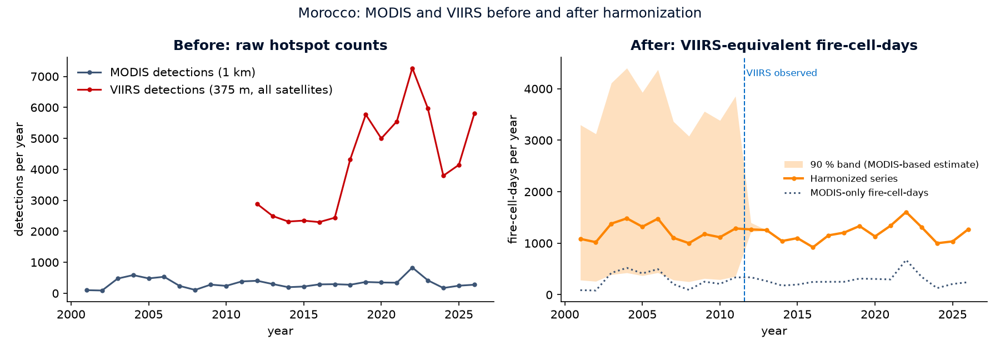
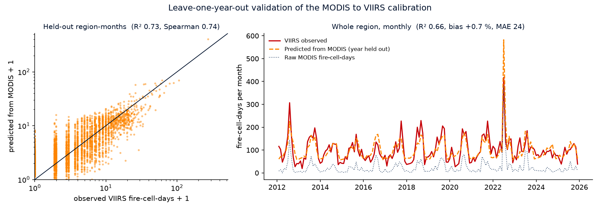
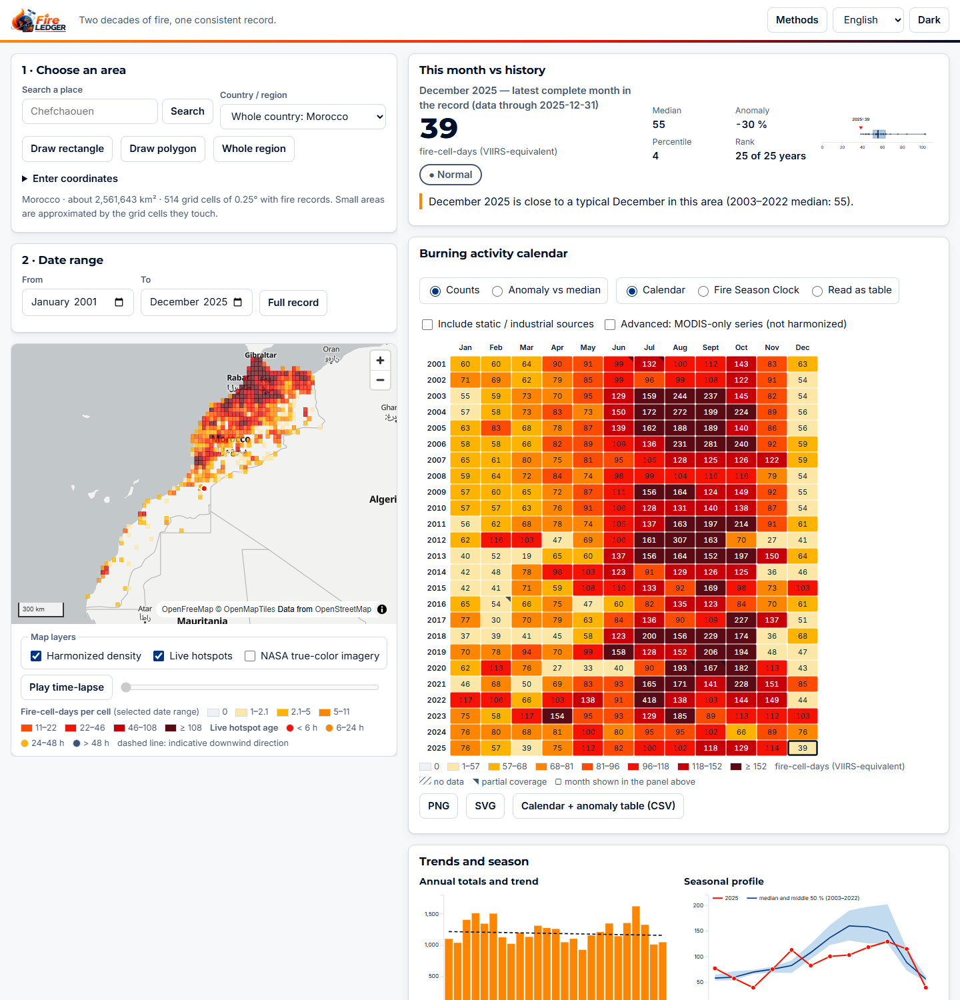
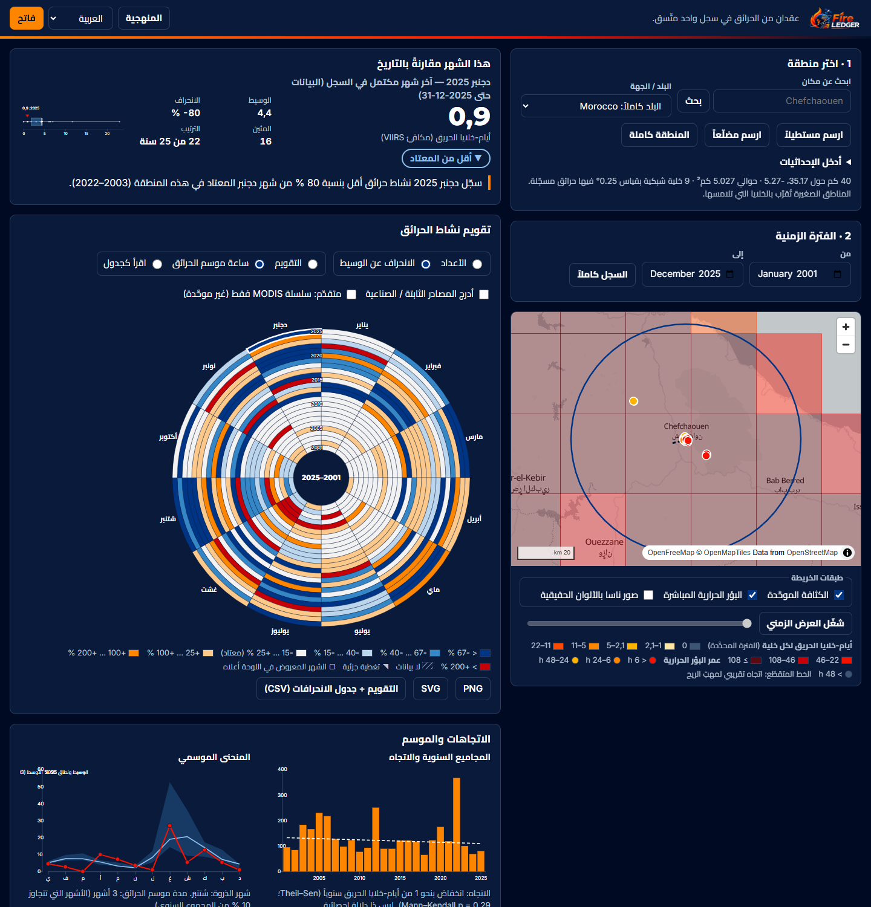
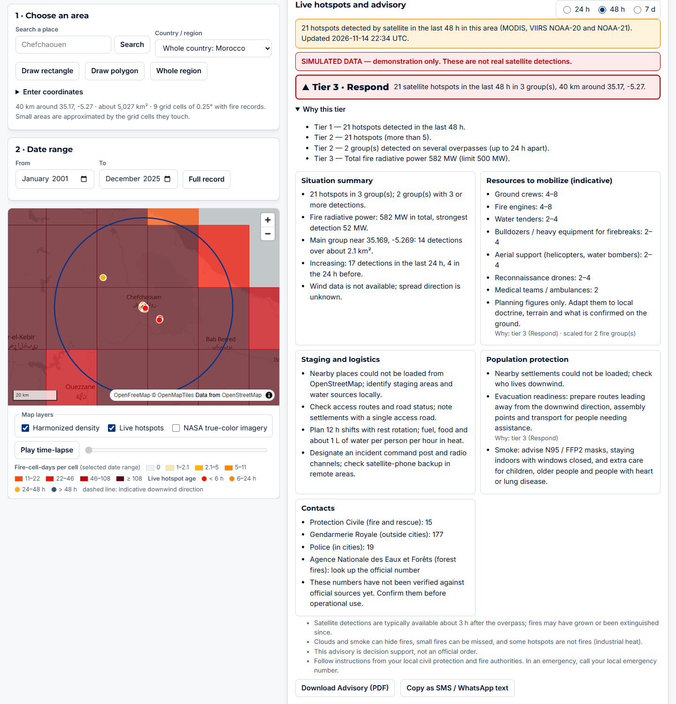

<p align="center"></p>

# FireLedger — Harmonized Burning Activity Calendar

*Two decades of fire, one consistent record.*

| | |
|---|---|
| Challenge | NASA Space Apps Challenge 2026 — burning activity calendar |
| Team | *to be completed by the team* |
| Live URL | https://fireledger.earth *(domain registered; deployment pending, see §7.4)* |
| Repository | https://github.com/KHDEVAM/FireLedger |
| Date | 15 November 2026 |
| Demo region | Morocco, January 2001 → December 2025 |

---

## 1. Executive summary

Satellite fire records changed instrument halfway through. MODIS has seen fires since 2000 with 1 km pixels; VIIRS, since 2012, sees the same fires with 375 m pixels and also detects small fires MODIS misses. Raw hotspot counts therefore jump when the sensor changes, and nobody can say honestly whether "this month" is unusual compared with twenty years of history.

FireLedger harmonizes both NASA FIRMS records into one unit — VIIRS-equivalent *fire-cell-days* — and shows it as an interactive year × month burning calendar for any area a user draws, types or searches. It answers in one sentence whether the latest month is normal, shows trends and the fire season, and exports the hotspots, the calendar table, charts and a one-page PDF briefing. When live hotspots are present it opens a transparent, rule-based Response & Logistics Advisory.

For Morocco, the harmonized series reproduces held-out VIIRS years with a monthly R² of 0.66 and a bias of +0.7 %, with one third of the error of raw MODIS. The busiest month of the record is July 2022, matching the reported northern Morocco fires.

## 2. Problem statement

MODIS and VIIRS active-fire detections cannot be compared directly:

- **Resolution.** One fire lights several 375 m VIIRS pixels but one or two 1 km MODIS pixels. In Morocco, VIIRS S-NPP alone reports about four times as many detections as MODIS Terra + Aqua together.
- **Sensitivity.** VIIRS detects smaller and cooler fires. Many low-intensity fires never appear in MODIS at all.
- **Overpass times.** Terra crosses in the morning, Aqua and the VIIRS satellites in the early afternoon and at night; fires with a daily cycle are sampled differently.
- **Constellation changes.** Terra flew alone until mid-2002; S-NPP was joined by NOAA-20 (2018) and NOAA-21 (2024); NOAA ended all Suomi NPP data delivery on 2 November 2026 [8][9]. More satellites mean more detections of the same fire.

## 3. Data

| # | Sensor / product | Version | Resolution | Used record (Morocco) | Rows used | Access |
|---|---|---|---|---|---|---|
| 1 | MODIS Terra + Aqua, MCD14ML (standard) | C6.1 | ~1 km | 10 Dec 2000 → 23 Dec 2025 | 7,908 | FIRMS yearly country files |
| 2 | VIIRS S-NPP, VNP14IMGT (standard) | 2 | 375 m | 20 Jan 2012 → 30 Dec 2025 | 32,316 | FIRMS yearly country files |
| 3 | VIIRS NOAA-20, VJ114IMGT (standard) | 2 | 375 m | 1 Apr 2018 → 31 Dec 2025 | 19,688 | FIRMS yearly country files |
| 4 | MODIS NRT (MCD14DL), VIIRS NOAA-20 NRT, VIIRS NOAA-21 NRT | C6.1 / 2 | 1 km / 375 m | last 7 days, on request | live | FIRMS area API through a server-side proxy |

Rows are counts after the confidence filter (59,912 of 64,817 downloaded). The 2026 yearly files are not published yet, and no FIRMS MAP_KEY was available during the build, so the record currently ends on 31 December 2025; `pipeline/01_download.py` fills the tail from the area API as soon as a key is set. Supporting non-NASA data (basemap, boundaries, weather, places) are listed in §11 and in `SOURCES.md`.

## 4. Methods

All steps are scripts in `pipeline/` that run from the raw files; thresholds are in `pipeline/config.yaml`.

### 4.1 Cleaning and filtering (`02_clean.py`)
- One schema for both sensors (`bright_ti4`↔`brightness`, `bright_ti5`↔`bright_t31`).
- Confidence: MODIS ≥ 30; VIIRS nominal or high (low dropped).
- `type == 0` (presumed vegetation fire) by default. Types 1–3 are kept in a second variant behind the "Include static / industrial sources" toggle (Morocco: 15,236 static-source detections).
- Standard processing (SP) wherever available. Per satellite, NRT rows are kept only after the last SP date, so SP and NRT are never counted twice.

### 4.2 Fire-cell-days (`03_grid.py`)
Detections are snapped to a common 0.01° grid (~1 km). Per sensor series and day, each cell counts once. Clusters of VIIRS pixels collapse to MODIS-like footprints, and satellites of one family are merged by union. A single-satellite VIIRS reference avoids the constellation effect: S-NPP for 2012–2018, then NOAA-20 scaled to S-NPP (factor 0.897 from their 2019–2025 overlap). NOAA-20 therefore carries the record now that S-NPP has ended. Terra-only months before July 2002 are scaled to a Terra + Aqua equivalent (factor 1.98).

### 4.3 Cross-calibration (`04_harmonize.py`)
- **Overlap:** February 2012 → December 2025 (167 months).
- **Calibration regions:** 1° cells where data allow (208 display cells), otherwise 5° cells (277), otherwise the whole domain (61).
- **Candidate models** on monthly regional totals: ratio `V = k·M`; log-log `log(V+1) = a + b·log(M+1)`; and a seasonal model `V = s[month] + k·M` with a non-negative background `s` of small fires that only VIIRS sees.
- **Selection** by leave-one-year-out cross-validation; the seasonal model won (Table in §5).
- **Target unit:** VIIRS-equivalent fire-cell-days. January 2001 → January 2012 is backcast from MODIS; from February 2012 the VIIRS reference is used as observed.
- **Cell level:** the MODIS-proportional part goes to the cells where MODIS saw fire; the background is spread by each cell's VIIRS climatology for that calendar month.
- **Uncertainty:** a 90 % band from the cross-validation log residuals, shown in tooltips as "estimated from MODIS (−x % / +y %)". For an area, per-cell bands are combined in quadrature (cells treated as independent — an approximation).
- A MODIS-only, non-harmonized series is kept behind an "Advanced" toggle as a sanity check.

### 4.4 Anomaly and trend metrics (`05_aggregate.py`, recomputed in the browser for any area)
- Baseline: median of the same calendar month over 2003–2022, excluding the month's own year.
- `anomaly % = (count − median) / max(median, 1)`; robust z = `(count − median) / (1.4826 · MAD)`; percentile and rank among all years.
- Classes: below normal (< −40 %), normal, above normal (> +50 %), extreme (> +200 %), each shown with a label and an icon, never by color alone.
- Trend: Theil–Sen slope with the Mann–Kendall test. Fire season length: months with more than 10 % of the annual total.
- Months without satellite coverage are "no data" (hatched), never zero; months with a known sensor outage are marked partial.

### 4.5 Advisory engine (`web/src/advisory/`)
Rule-based, configurable in `advisory/config.json`; every tier change is listed with the numbers that caused it.

| Tier | Label | Trigger |
|---|---|---|
| 0 | Monitor | no hotspots in the window |
| 1 | Watch | any hotspot |
| 2 | Prepare | more than 5 hotspots, or a group seen ≥ 6 h apart, or anomaly > +100 %, or wind > 30 km/h |
| 3 | Respond | strongest detection ≥ 100 MW, or total ≥ 500 MW, or ≥ 3 groups of ≥ 3 detections, or a settlement < 5 km |
| 4 | Emergency | tier 3 and humidity < 25 % and wind ≥ 30 km/h toward a settlement (±30°, 25 km) |

Hotspots are grouped within 1.5 km. Wind and humidity come from Open-Meteo; settlements, hospitals, schools, water points and staging candidates from OpenStreetMap. Outputs: situation summary with an indicative downwind vector, resources, staging and logistics, population protection, agricultural-burn context, post-fire actions, contacts, a ≤ 600-character SMS text and a PDF.

## 5. Validation and results

Leave-one-year-out over 2012–2025: each year is predicted from MODIS with a model fitted on the other years.

| Model (whole region, monthly, n = 167) | R² | MAE (fire-cell-days) | Bias | Spearman | Calendar-rank Spearman |
|---|---|---|---|---|---|
| Raw MODIS (no harmonization) | −1.34 | 75.9 | −76.0 % | 0.84 | — |
| Ratio | −1.58 | 46.3 | +4.1 % | 0.79 | 0.71 |
| Log-log | −0.05 | 46.8 | −46.6 % | 0.84 | 0.77 |
| **Seasonal (selected)** | **0.66** | **23.6** | **+0.7 %** | **0.77** | **0.76** |

At region-month level (n = 3,507) the selected model reaches R² 0.73 and MAE 2.4.




**Golden-event check.** The busiest month in the harmonized record is July 2022 (418 fire-cell-days; next is August 2012 with 307). This matches the fires that broke out in mid-July 2022 in the provinces of Larache, Ouezzane, Taza and Tétouan, with at least 4,660 hectares reported burned by 18 July [10][11]. 2022 is also the busiest year.

**Other results for Morocco.** Peak month August; fire season four months; no significant trend in annual totals (Theil–Sen −1.8 fire-cell-days per year, Mann–Kendall p = 0.83).

**Known limitations of the method.**
- Raw MODIS ranks months slightly better than the harmonized series (Spearman 0.84 vs 0.77). Harmonization fixes the level, not the ordering.
- In the worst held-out year the calendar-rank correlation falls to 0.38.
- Much of a backcast month is seasonal background, so pre-2012 months vary less from year to year than observed VIIRS months, most visibly in winter and in small areas. Pre-2012 anomalies are conservative.
- The band is wide for single cells (log-residual σ ≈ 0.60 at domain level).
- The daily table can only date the MODIS-proportional part before 2012.
- Known outages are a short list in the config; the FIRMS missing-data API was not queried (no key).

## 6. Automated checks

26 Python tests (`tests/`) and 16 web tests (`web/tests/`) pass. They cover: deterministic grid snapping; no SP/NRT double counting; pixel clusters collapsing to one fire-cell-day and satellites merging by union; no-data months staying NaN/empty; overlap totals within the validation band; API input validation and the MAP_KEY never appearing in responses; area selection; anomaly math; the calendar CSV matching on-screen totals; advisory tiers; and translation completeness.

## 7. Application

### 7.1 Architecture

```
FIRMS yearly country files ──► pipeline/ (Python) ──► web/public/data/<region>/  (static JSON + CSV)
                                                                │
Browser ──► static site (Vite + TypeScript + MapLibre GL + D3) ─┘
   │
   └─ /api/* ──► Lambda (Python 3.12): nrt → FIRMS area API (key in SSM, S3 cache 15 min)
                                       weather → Open-Meteo        export → FIRMS CSV
EventBridge Scheduler (3 h) ──► Lambda refresh: warms the cache, checks watch zones
```

### 7.2 Features
- Area: draw a rectangle or polygon, enter lat/lon + radius or a bounding box, search a place, or pick one of 12 regions. The state is in a shareable URL.
- Date range; calendar heatmap with counts or anomaly colors, tooltips with median, anomaly, percentile and source note; Fire Season Clock; table view.
- "This month vs history" panel with a box plot and a one-sentence "Is this normal?" answer.
- Annual totals with trend, seasonal profile, ten busiest months; time-lapse of the monthly density map.
- Downloads: raw hotspots CSV, calendar + anomaly CSV, PNG/SVG of charts, PDF briefing.
- Live hotspots colored by age, NASA GIBS true-color imagery, advisory panel.
- English, French and Arabic (right-to-left); light and dark themes; installable with offline cache.





The advisory screenshot uses the built-in demonstration mode (`?demo=1`), which is labeled "SIMULATED DATA" on screen and in exports.

### 7.3 Accessibility
- Count ramp from the logo's heat calendar with steadily falling lightness; anomaly ramp blue ↔ orange/red, never red–green.
- No-data is a hatch pattern, not a ramp color. Anomaly badges carry a label and an icon.
- Every chart has a "Read as table" alternative; the calendar is keyboard-navigable with arrow keys; coordinate entry replaces drawing for keyboard users.
- Not yet done: a color-vision-deficiency simulator pass on the ramps and a Lighthouse audit.

### 7.4 Hosting
Planned on AWS with the team's credits, region eu-west-3: Amplify Hosting for the static site, three Lambda Function URLs behind Amplify `/api/*` rewrites, S3 cache, SSM Parameter Store for the MAP_KEY, EventBridge Scheduler, CloudWatch logs with 7-day retention. The domain fireledger.earth stays at Porkbun and is pointed at Amplify with an ALIAS record for the root, a CNAME for `www`, and the ACM validation CNAME.

**Status: not deployed yet.** `infra/template.yaml`, `amplify.yml` and `customHttp.yml` are written, but the SAM template has not been validated or deployed, and the live FIRMS feed has not been exercised with a real key. Locally, `api/dev_server.py` runs the same handlers; the weather endpoint returned real data and the FIRMS endpoint was tested with mocked responses only.

Expected cost at hackathon traffic is a few US dollars per month or less (estimate, not measured): Lambda, S3, SSM and EventBridge fall within free-tier-scale usage, and Amplify Hosting bills build minutes and data transfer.

## 8. Limitations and responsible use

- Satellite detections arrive about three hours after the overpass; a fire may have grown or gone out since.
- Clouds and smoke hide fires; small or short fires can be missed; some hotspots are industrial heat.
- The app never says "safe" or "no fire", only "no hotspots detected by satellite in the last X h".
- Values before February 2012 are estimates from MODIS with the limits listed in §5.
- Areas are resolved on a 0.25° grid; small areas are approximated by the cells they touch. The raw hotspot CSV is filtered exactly.
- Population figures in the advisory are sums of OpenStreetMap tags and are incomplete. Land cover is not used yet.
- The Morocco emergency numbers (15, 177, 19) match a Fondation Mohammed V directory but were not confirmed on a government site; the app marks them as unverified.
- The advisory is decision support, not an official order. Follow local civil protection and fire authorities.

## 9. Future work

- Deploy, add the 2026 tail and the FIRMS missing-data flags, and widen to more countries.
- Calibrate NOAA-21 against NOAA-20 as its record grows, so it can fill gaps.
- Burned-area products (MCD64A1, VIIRS burned area) and FRP-weighted calendars.
- Land cover (MCD12Q1) for the advisory and for calibration regions; a population grid.
- Watch zones with e-mail alerts (the scheduled function and the SES hook exist; the UI does not), side-by-side comparison of two areas.
- Anomaly detection with machine learning; partnership with national fire services.

## 10. Use of AI tools

An AI coding assistant was used throughout development: to draft and refactor the pipeline, web application, API handlers, infrastructure template, tests and this report, and to run and check them. The team defined the project, method requirements, brand and data sources. Validation numbers in this report are outputs of the pipeline run on FIRMS data, not generated text. The logo was provided by the team.

## 11. References and data citations

1. **NASA FIRMS acknowledgment.** We acknowledge the use of data and/or imagery from NASA's Fire Information for Resource Management System (FIRMS) (https://earthdata.nasa.gov/firms), part of NASA's Earth Observing System Data and Information System (EOSDIS). Citation page: https://www.earthdata.nasa.gov/learn/find-data/near-real-time/citation
2. MODIS Collection 6.1 standard active fire, MCD14ML. doi:10.5067/FIRMS/MODIS/MCD14ML
3. MODIS Collection 6.1 NRT active fire, MCD14DL. doi:10.5067/FIRMS/MODIS/MCD14DL.NRT.0061
4. VIIRS 375 m active fire, Suomi NPP, VNP14IMGT. doi:10.5067/FIRMS/VIIRS/VNP14IMGT_NRT.002
5. VIIRS 375 m active fire, NOAA-20, VJ114IMGT. doi:10.5067/FIRMS/VIIRS/VJ114IMGT_NRT.002
6. VIIRS 375 m active fire, NOAA-21, VJ214IMGTDL_NRT. doi:10.5067/VIIRS/VJ214IMG_NRT.002
7. Giglio, L., Schroeder, W., & Justice, C.O. (2016). The collection 6 MODIS active fire detection algorithm and fire products. *Remote Sensing of Environment*, 178, 31–41. doi:10.1016/j.rse.2016.02.054 — Schroeder, W., Oliva, P., Giglio, L., & Csiszar, I.A. (2014). The New VIIRS 375 m active fire detection data product: algorithm description and initial assessment. *Remote Sensing of Environment*, 143, 85–96. doi:10.1016/j.rse.2013.12.008
8. NASA Earthdata, "Transitioning from Suomi NPP VIIRS & OMPS: What FIRMS Users Need to Know". https://www.earthdata.nasa.gov/news/blog/transitioning-from-s-npp-viirs-omps-what-nasa-firms-users-need-know
9. NOAA NESDIS, cessation of Suomi NPP data. https://www.nesdis.noaa.gov/news/cessation-of-suomi-national-polar-orbiting-partnership-s-npp-data-users-onafter-november-2-2026
10. Al Jazeera (18 July 2022), "Photos: Firefighters, soldiers battle Morocco's forest blazes". https://www.aljazeera.com/gallery/2022/7/18/photos-firefighters-soldiers-battle-moroccos-forest-blazes
11. Africanews (18 July 2022), "Morocco's largest fires about to be contained — Authorities". https://www.africanews.com/amp/2022/07/18/moroccos-largest-fires-about-to-be-contained-authorities
12. NASA GIBS, `VIIRS_NOAA20_CorrectedReflectance_TrueColor`. https://gibs.earthdata.nasa.gov/ — "Imagery: NASA GIBS / EOSDIS".
13. OpenFreeMap vector tiles, Positron style; © OpenStreetMap contributors, ODbL 1.0. https://openfreemap.org/ (accessed 14 Nov 2026)
14. geoBoundaries gbOpen, MAR ADM1 (`MAR-ADM1-70788906`), ODbL 1.0. Runfola, D. et al. (2020). *PLoS ONE* 15(4): e0231866. doi:10.1371/journal.pone.0231866 (accessed 14 Nov 2026)
15. Open-Meteo forecast API, CC BY 4.0 — "Weather data by Open-Meteo.com". https://open-meteo.com/ (accessed 14 Nov 2026)
16. OpenStreetMap via Overpass API (overpass-api.de) and Nominatim, ODbL 1.0 — "© OpenStreetMap contributors" (accessed 14 Nov 2026)
17. Fonts: Montserrat, Inter, Cairo — SIL Open Font License 1.1, self-hosted through `@fontsource`.
18. Fondation Mohammed V pour la Solidarité, Marhaba emergency contacts (used to cross-check the Morocco emergency numbers). https://www.lesmre.com/fr/actualites/marhaba-2026-contacts-urgence-fondation-mohammed-v
19. Software: MapLibre GL JS 4.7, D3 7, jsPDF 2, Vite 5, TypeScript 5, Vitest 2; pandas 2, NumPy 2, PyArrow, Matplotlib 3, Requests, PyYAML, Pillow, pytest. Exact web versions are in `web/package-lock.json`.

**Cross-check of sources.** External hosts in the code: `firms.modaps.eosdis.nasa.gov` [1–6], `gibs.earthdata.nasa.gov` [12], `tiles.openfreemap.org` [13], `www.geoboundaries.org` [14], `api.open-meteo.com` [15], `overpass-api.de` and `nominatim.openstreetmap.org` [16]. Each appears above and in `SOURCES.md`.

NASA does not endorse any non-U.S. Government entity and is not responsible for information contained on non-U.S. Government websites.
